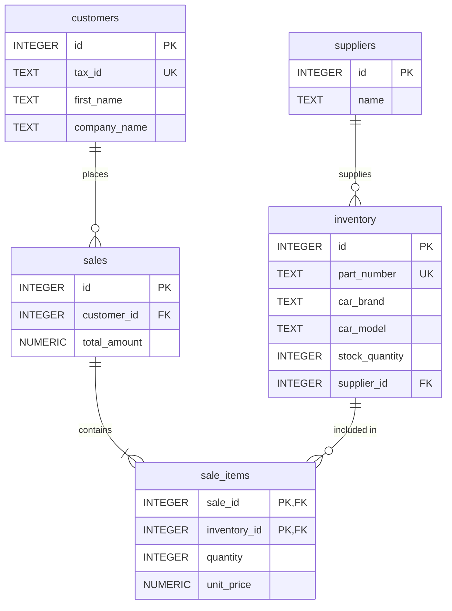

# Design Document

By Jhosep Cristopher Cordova Alvarez

Video overview: [https://youtu.be/j6gSxLrD7IM](https://youtu.be/j6gSxLrD7IM)

## Scope

The purpose of this database is to provide a robust, normalized backend system for "Parabrisas Importados", a real-world auto glass retail and installation business located in Surquillo, Lima, Peru. The system is designed to transition the business from manual or spreadsheet-based tracking to a scalable relational database, optimizing inventory management, supplier relations, and sales tracking.

The scope of this database includes:
- **Customers**: Both individual consumers (B2C) and corporate clients such as auto repair shops (B2B).
- **Suppliers**: The wholesale providers of auto glass parts.
- **Inventory**: Detailed tracking of auto glass parts, categorized by car brand, model, compatible years, and glass type (e.g., front windshield, rear window).
- **Sales Transactions**: Records of purchases, including the specific line items sold, total amounts, and payment methods.

*Outside* the scope of this database are:
- Employee payroll and human resources management.
- Complex tax accounting and ledger reconciliation (which would be handled by specialized accounting software).
- Shipping logistics and delivery route tracking.
- Historical price tracking of inventory items (the database currently reflects the most up-to-date retail price).

## Functional Requirements

A user (such as the store manager or a sales clerk) should be able to:
- Register new customers (both individuals with a DNI and corporate entities with a RUC) and update their contact information.
- Add new auto glass parts to the inventory when new shipments arrive from suppliers.
- Quickly search the inventory to determine if a specific glass part is in stock for a customer's specific car brand and model.
- Process a sales transaction, which automatically links the customer, the items purchased, and the total cost.
- Automatically track stock depletion (stock quantity decreases when a sale is recorded via application-level logic or updates).
- Query low-stock alerts to know exactly which parts need to be reordered from suppliers.
- Generate monthly sales summaries to analyze business performance and revenue trends.

Beyond the scope of what a user should be able to do:
- A user cannot process credit card payments directly through this database (payment gateways are external).
- A user cannot manage multi-branch inventory (the current design assumes a single physical store location in Surquillo).

## Representation

### Entities

I chose to represent the following entities in the database, normalized to the Third Normal Form (3NF) to reduce data redundancy:

1. **`customers`**: Represents the buyers.
    - `id`: `INTEGER PRIMARY KEY`.
    - `first_name`, `last_name`: `TEXT`. Can be NULL for corporate clients.
    - `company_name`: `TEXT`. Can be NULL for individual clients.
    - `tax_id`: `TEXT UNIQUE`. Represents the Peruvian DNI or RUC. It is UNIQUE to prevent duplicate customer profiles.
    - `phone`, `email`: `TEXT`.

2. **`suppliers`**: Represents the wholesale distributors.
    - `id`: `INTEGER PRIMARY KEY`.
    - `name`: `TEXT NOT NULL`. The business name of the supplier.
    - `contact_name`, `phone`, `address`: `TEXT`.

3. **`inventory`**: Represents the physical auto glass stock.
    - `id`: `INTEGER PRIMARY KEY`.
    - `part_number`: `TEXT NOT NULL UNIQUE`. A unique SKU or manufacturer identifier.
    - `car_brand`, `car_model`, `glass_type`: `TEXT NOT NULL`. Essential for fast searching.
    - `year_start`, `year_end`: `INTEGER NOT NULL`. Represents the vehicle generation compatibility.
    - `price`: `NUMERIC NOT NULL`. Used `NUMERIC` instead of `REAL` to avoid floating-point math precision errors when dealing with money.
    - `stock_quantity`: `INTEGER NOT NULL DEFAULT 0`.
    - `supplier_id`: `INTEGER`. A Foreign Key linking to `suppliers`.

4. **`sales`**: Represents the transaction header.
    - `id`: `INTEGER PRIMARY KEY`.
    - `customer_id`: `INTEGER NOT NULL`. Foreign Key linking to `customers`.
    - `sale_date`: `NUMERIC NOT NULL DEFAULT CURRENT_TIMESTAMP`. Stores the exact moment of the transaction.
    - `total_amount`: `NUMERIC NOT NULL`.
    - `payment_method`: `TEXT`.

5. **`sale_items`**: A junction table representing the many-to-many relationship between sales and inventory.
    - `sale_id`: `INTEGER`.
    - `inventory_id`: `INTEGER`.
    - `quantity`: `INTEGER NOT NULL`.
    - `unit_price`: `NUMERIC NOT NULL`. Stored at the time of sale, ensuring that if the base price in `inventory` changes later, historical sales records remain accurate.
    - The Primary Key is a composite of `(sale_id, inventory_id)`.

### Relationships

Below is the Entity Relationship Diagram for the database, built using Mermaid.js syntax:

- A **Customer** can place zero or many **Sales** (1-to-N).
- A **Supplier** can supply zero or many **Inventory** items (1-to-N).
- A **Sale** must contain one or many **Sale Items** (1-to-N).
- An **Inventory** item can be included in zero or many **Sale Items** (1-to-N).

## Optimizations

To ensure the database operates efficiently under typical operational workloads, the following optimizations were implemented:

1. **Indexes on Frequently Searched Columns**:
   - `idx_inventory_car` on `inventory("car_brand", "car_model")`: The most common query in an auto glass shop is a customer asking, "Do you have a windshield for a Toyota Yaris?". This composite index uses a B-Tree structure to change an expensive table SCAN into an efficient SEARCH.
   - `idx_customers_tax_id` on `customers("tax_id")`: Speeds up customer retrieval during the billing process.
   - `idx_sales_customer` on `sales("customer_id")`: Optimizes `JOIN` operations when looking up a customer's purchase history.

2. **Views for Business Intelligence and Operations**:
   - `low_stock_alerts`: Abstracts a `WHERE stock_quantity < 5` query into a simple view, allowing store managers to instantly see which parts need to be reordered without writing SQL.
   - `monthly_sales_summary`: Aggregates transaction data using `COUNT`, `SUM`, and `GROUP BY` on the `sale_date`. This acts as a reporting layer, similar to a Gold layer in a data engineering pipeline, providing clean business metrics.

## Limitations

Despite its robust design, this database schema has a few limitations due to the constraints of SQLite and the initial scope:

- **No Soft Deletes**: Deleting a customer or an inventory item will permanently remove it or cause a Foreign Key constraint violation if they are tied to a sale. A better approach for a production MySQL/PostgreSQL system would be adding an `is_active` boolean column.
- **Lack of ENUMs in SQLite**: Unlike MySQL, SQLite does not enforce ENUM types natively. The `glass_type` and `payment_method` columns are `TEXT`, which opens the door for data entry typos (e.g., typing 'Ypae' instead of 'Yape'). Application-level validation is required.
- **Concurrency**: Since SQLite is a file-based database, it handles concurrent read operations well, but heavy concurrent write operations (e.g., if the business expands to 10 branches writing sales simultaneously) could lead to database locks. Migrating to PostgreSQL would be necessary for multi-branch scaling.